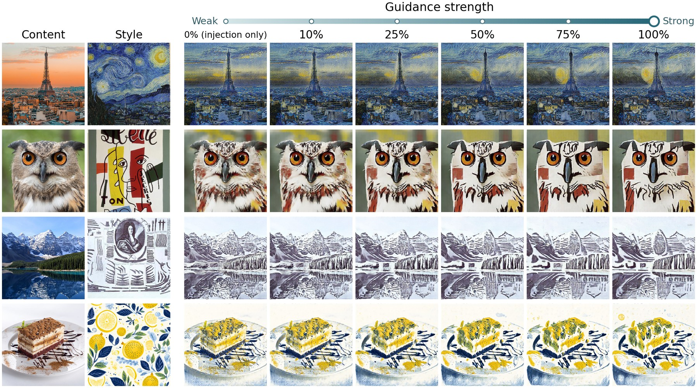

# MotifFlow: Training-Free, Self-Contained Style Transfer from Color to Motif in Rectified Flow Transformers

Chun Xie, Itaru Kitahara — University of Tsukuba

[**Paper (arXiv:2611.33371)**](https://arxiv.org/abs/2611.33371)

> **Code coming soon.** This repository will host the official implementation of MotifFlow.



*Each row shows one content–style pair at six guidance strengths. At 0% only attention injection is active,
which transfers the palette. Raising the strength develops the brushwork and then the characteristic motifs
of the style image, while the content structure is retained.*

## Overview

MotifFlow transfers the style of a reference image to a content image with a frozen FLUX model. It needs no
training, no adapter and no auxiliary image encoder: style encoding, guidance and synthesis all use the same
backbone.

Attention injection works well in U-Net diffusion models, but in FLUX it mostly transfers color and misses
the distinctive brushwork of the style. MotifFlow keeps injection and adds **style alignment guidance**:
the discrepancy between the model's own attention output and the injected attention output guides updates
of the latent, so the image being generated develops the brushwork and motifs of the style by itself.

- **Training-free and self-contained.** A single frozen backbone; nothing is fine-tuned or added.
- **One strength control.** A single parameter moves the result from color transfer to pronounced brushwork
  and motifs.
- **Regional stylization and style mixing.** Guidance can be restricted to a region of the content image,
  directed at selected elements of the style image, or shared between two styles.
- **Beyond FLUX.1.** The same design extends to FLUX.2.

## Release plan

- [ ] Inference code for FLUX.1 (stylization with strength control)
- [ ] Regional stylization and style mixing
- [ ] FLUX.2 support
- [ ] Evaluation scripts

## Citation

```bibtex
@article{xie2026motifflow,
  title   = {MotifFlow: Training-Free, Self-Contained Style Transfer from Color to Motif in Rectified Flow Transformers},
  author  = {Xie, Chun and Kitahara, Itaru},
  journal = {arXiv preprint arXiv:2611.33371},
  year    = {2026}
}
```
